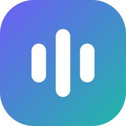

<p align="center">
  
</p>

<h1 align="center">Just Say</h1>

https://github.com/user-attachments/assets/882ac5ab-85d1-4862-bf72-17661edb843a

<p align="center">
  <a href="../../releases/latest"><b>Baixar a versão mais nova</b></a>
</p>

Ditado por voz para Windows: você toca um atalho, fala, e o texto entra limpo e pontuado no campo onde o cursor está, em qualquer programa. Também responde perguntas (Just Ask), traduz enquanto você fala e anota no Notion.

## O que ele faz

### 🎙️ Ditado com reescrita inteligente
Toque **AltGr**, fale do seu jeito e toque de novo. O texto entra no campo onde está o cursor, em qualquer programa: WhatsApp, Gmail, Word, Notion, VS Code…

E ele não só transcreve, ele **reescreve**:
- tira os "éé", "tipo", "né" e as repetições;
- põe pontuação e letra maiúscula onde precisa;
- entende quando você se corrige no meio: *"amanhã às três, não, às quatro"* vira **"Amanhã às quatro."**;
- lê o que está na tela para acertar nomes e o tom da conversa.

### 💬 Just Ask: pergunte ou peça qualquer coisa
Toque **AltGr + Espaço** e fale um pedido. O app decide sozinho o que fazer:
- **Escrever por você:** *"escreve um e-mail pedindo o orçamento"* → o e-mail pronto é colado no campo.
- **Editar o que está selecionado:** selecione um texto e diga *"organiza isso em tópicos"* ou *"deixa mais formal"*.
- **Responder:** *"o que é isso?"* sobre algo na tela → a resposta aparece num cartão, pronta para copiar.
- **Pesquisar na web:** *"qual a cotação do dólar hoje?"* → resposta com as fontes, sem abrir o navegador.
- **Anotar no Notion:** *"anota esse vídeo pra ver mais tarde"* → vira um item na sua lista.

### 🌎 Tradução enquanto você fala
Toque **AltGr + Shift direito** e fale em português: o texto sai direto em inglês, espanhol ou outro idioma. Você escolhe até 3 idiomas de destino, entre 24 opções.

### ✨ E mais
- **Aprende com você:** se você corrige um nome depois de colar, ele entra no seu dicionário. O app também pega o seu jeito de escrever.
- **Histórico:** tudo o que você ditou fica salvo, com busca e botão de copiar. Dá até para refazer um ditado a partir do áudio.
- **Silencia o som de fundo** enquanto você fala (dá para desligar).
- **Privacidade:** apps de senha, conversas privadas e terminais nunca têm o texto lido. Tudo fica no seu PC, com a sua própria chave do Groq.
- **Funciona sem internet (opcional):** com uma placa de vídeo NVIDIA, a transcrição e a limpeza rodam no seu PC (Whisper + Qwen3.5 no llama.cpp; ver `server/local-whisper/LEIA-ME.md`).
- **Grátis:** usa o plano gratuito do Groq.

Os atalhos acima são os padrões; dá para trocar em **Configurações**.

## Como rodar (Windows 10/11)

1. Baixe a versão mais nova em **[Releases](../../releases/latest)** (o arquivo `Source code (zip)`) e extraia numa pasta sua, por exemplo `Documentos\just-say`.
2. Clique duas vezes em **`Instalar.cmd`** (uma vez só; leva alguns minutos).
3. Clique duas vezes em **`Abrir Just Say.cmd`**. O app fica no ícone ao lado do relógio.

Não precisa instalar o Node.js antes: se o PC não tiver o Node 22 ou mais novo, o `Instalar.cmd` baixa um Node portátil do nodejs.org, confere a impressão digital (SHA-256) e o guarda em `runtime\node`, dentro da pasta. Não pede administrador e não mexe no resto do PC; para remover, é só apagar a pasta.

O app sobe o servidor local sozinho (`server/`, porta 8787, só aceita pedidos do próprio PC).

## Versões e atualização

Cada versão tem um número (`v0.1.0`, `v0.2.0`…) e uma nota do que mudou, em [Releases](../../releases) e no [CHANGELOG](CHANGELOG.md).

**Atualizar pelo app (a partir da v0.1.4):** quando sai uma versão nova, aparece no **Painel** (e em **Configurações → Atualizações**) o botão **Atualizar agora**. Ele baixa só o código novo (cerca de 1 MB), reaproveita as bibliotecas que já estão no PC (só baixa de novo as que mudaram), fecha o Just Say e abre já atualizado, na mesma pasta. Se algo der errado, ele volta sozinho para a versão anterior. A versão anterior fica guardada em `<pasta>.anterior`, ao lado da sua, até a próxima atualização.

**Atualizar à mão** (ou vindo da v0.1.3 ou anterior, que ainda não têm o botão):

1. Feche o Just Say pelo ícone ao lado do relógio (**Sair**).
2. Baixe e extraia a versão nova numa pasta nova.
3. Copie a pasta **`server\data`** da instalação antiga para a nova: é lá que ficam o dicionário, o estilo de escrita e as escolhas de modelos. Se você usa um `server\.env`, copie também.
4. Rode o **`Instalar.cmd`** da pasta nova e abra pelo **`Abrir Just Say.cmd`**. Depois, a pasta antiga pode ser apagada.

O resto (configurações do app, chave do Groq, histórico e gravações) fica em `%APPDATA%\Just Say`, fora da pasta do app, e continua lá de qualquer jeito.

Os `.cmd` usam o Prompt de Comando de propósito: num Windows novo, o PowerShell bloqueia o `npm` ("a execução de scripts foi desabilitada"). Quem preferir o terminal:

```bat
cd server && npm ci && cd ..\app && npm ci && npm run build && npm run start
```

## A chave do Groq

Na primeira abertura, o passo a passo pede a sua chave:

1. Entre em [console.groq.com/keys](https://console.groq.com/keys) (dá para usar a conta do Google).
2. Clique em **Create API Key** e copie a chave (`gsk_…`).
3. Cole no app e clique em **Guardar**.

A chave fica guardada criptografada no seu PC (pela sua conta do Windows) e dá para trocar em **Configurações → Chave do Groq**. Quem preferir pode usar o arquivo `server/.env` (modelo em `server/.env.example`).

## Pastas

- `app/`: o aplicativo (Electron + React). As DLLs nativas prontas ficam em `app/resources/native/`; o código delas está em `app/native/`.
- `server/`: o servidor local (Node + Fastify) que fala com o Groq, o Notion e a IA local.
- `app/DECISOES.md`: o porquê de cada escolha do projeto.

## As DLLs nativas

O app precisa de algumas coisas do Windows que o Node/Electron não alcança sozinho. Elas ficam em 4 DLLs pequenas, escritas em C++ e carregadas pelo app (via koffi). As prontas estão em `app/resources/native/`, para ninguém precisar do Visual Studio; o código-fonte completo está em `app/native/`.

| DLL | O que faz |
| --- | --- |
| `KeyboardHelper.dll` | Ouve o teclado e o mouse do Windows inteiro para reconhecer o seu atalho (ex.: AltGr) em qualquer programa. Só repassa ao app quais teclas estão apertadas; não guarda nem envia o que você digita. Engole apenas as teclas do atalho reconhecido. |
| `InputHelper.dll` | Cola o texto onde está o cursor: guarda o que havia no clipboard, coloca o texto, aperta Ctrl+V e devolve o clipboard como estava. Também lê o texto selecionado (para o Just Ask e a tradução). |
| `ContextHelper.dll` | Lê, pela acessibilidade do Windows (UI Automation), o app em foco, o endereço do site e o texto ao redor do cursor. Isso ajuda a IA a acertar nomes e o tom. Apps de senha, conversas privadas e terminais ficam de fora (ver `app/src/shared/contextLists.ts`). |
| `UtilHelper.dll` | Áudio e aparelho: silencia os outros programas enquanto você fala (e devolve o som depois), lista os microfones, sabe se a tampa do notebook está fechada e gera um identificador local do PC. |

Tudo isso roda só no seu PC. O que sai dele é o áudio e o contexto do ditado, para o Groq, com a sua chave.

**Antivírus.** Um programa que ouve o teclado do sistema inteiro se parece, para alguns antivírus, com um keylogger. Se o seu acusar a `KeyboardHelper.dll`, confira o código em `app/native/KeyboardHelper/` ou compile a sua própria (abaixo).

**Compilar você mesmo.** Precisa do Visual Studio Build Tools com "Desenvolvimento para desktop com C++". Depois:

```powershell
cd app
npm run native
```

O script compila `app/native/` com CMake + MSVC e copia as DLLs para `app/resources/native/`, por cima das prontas.

## Testes

```powershell
cd server; npm test
cd app;    npm test
```

## Licença

[MIT](LICENSE): pode usar, copiar, modificar e distribuir, mantendo o aviso de copyright. O software vem "como está", sem garantia.
